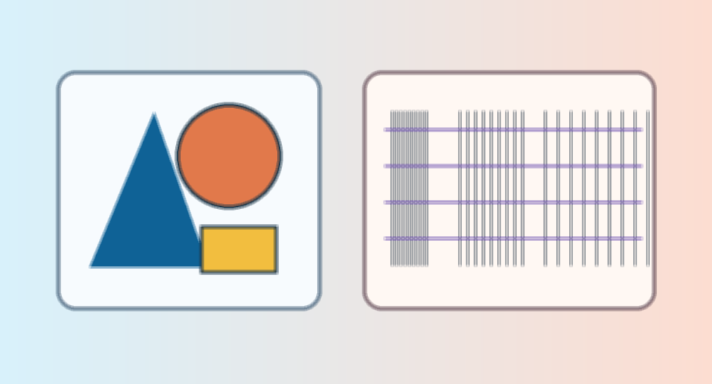
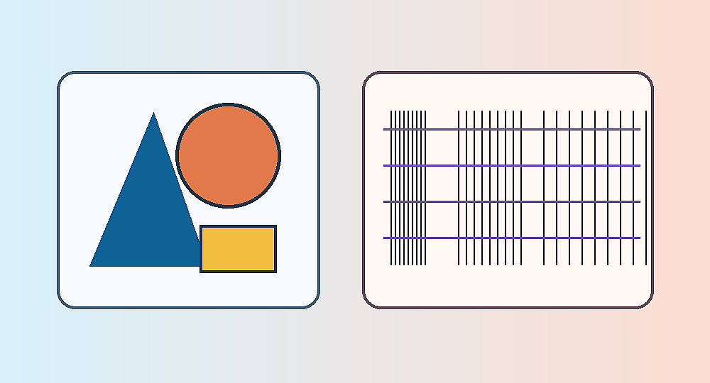

# Image Filters

[](https://github.com/TimofeiMenshikov/image_filters/actions/workflows/ci.yml)

Консольная утилита на Python для пакетной обработки изображений. Она размывает и повышает резкость каждого изображения во входной папке, а результаты сохраняет в отдельную папку. Поддерживает JPG, PNG, BMP, GIF и TIFF.

## Пример

На тонких линиях и краях фигур видно, как фильтры меняют изображение.

| [Исходное изображение](examples/input/filter-demo.png) | [Размытие](examples/output/filter-demo_blur.png) | [Повышение резкости](examples/output/filter-demo_sharpen.png) |
| --- | --- | --- |
|  |  |  |

## Запуск

Из корня репозитория установите пакет и запустите пример. Требуется Python 3.11 или новее.

```bash
python3 -m pip install .
python3 -m process_images --input-folder examples/input --output-folder examples/output
```

Для своих изображений укажите другую входную папку. К имени каждого выходного файла утилита добавляет `_blur` или `_sharpen`. Если не указать выходную папку, результаты сохранятся в `output/`. После установки доступна и команда `image-filters` с теми же параметрами.

## Тесты и CI

```bash
python3 -m pip install -e '.[dev]'
python3 -m pytest
```

[GitHub Actions](.github/workflows/ci.yml) запускает тесты с отчётом о покрытии, проверки Ruff и mypy, сборку пакета и [документации Sphinx](docs/).
